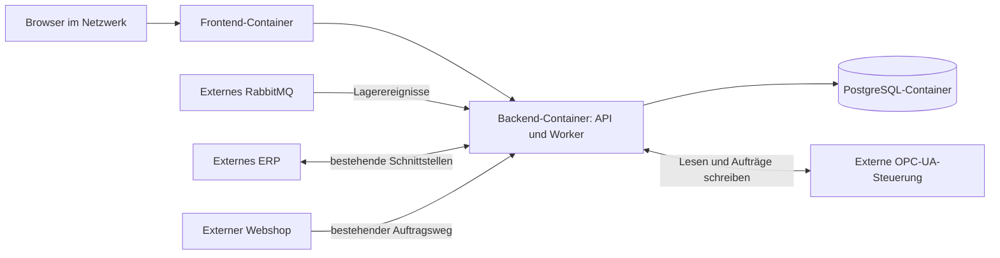

# [Projektwoche] MES-Weboberfläche und Datenaggregation — Spec und Aufgabenübersicht

<!-- meschede-projektwoche-v1:SDD-00 -->
## Ziel der Sammlung

MESchede in einer Projektwoche um eine echte Weboberfläche und Datenaggregation erweitern. Architektur: Synology NAS; genau drei MES-Container (Frontend, Backend, PostgreSQL); OPC UA, RabbitMQ, ERP und Webshop extern im Netzwerk. Vorgehen: Fachvertrag/Fixtures → Implementierung in getrennten Issues → belegte Abnahme.

## Aufgaben und Budget

- [ ] **SDD-01** — MVP-Spezifikation, API-Verträge und UI-Zustände festlegen (7 Teamstunden)
- [ ] **SDD-02** — OPC-UA-Spike: Nodes, Rückmeldungen und Start-/Ende-Handshake prüfen (5 Teamstunden)
- [ ] **SDD-03** — MES mit genau drei Docker-Services auf dem Synology NAS betreiben (8 Teamstunden)
- [ ] **SDD-04** — Aufträge, Läufe und Produktresultate in PostgreSQL persistieren (4 Teamstunden)
- [ ] **SDD-05** — OPC-UA-Status und Produktqueue lesen und persistente Läufe aktualisieren (8 Teamstunden)
- [ ] **SDD-06** — RabbitMQ-Lagerdaten konsumieren und aktuelle Bestände bereitstellen (4 Teamstunden)
- [ ] **SDD-07** — MES-Aggregations-API und dauerhafte manuelle Auftragsannahme umsetzen (6 Teamstunden)
- [ ] **SDD-08** — Persistente und validierte Konfigurations-API bereitstellen (6 Teamstunden)
- [ ] **SDD-09** — Frontend-Datenvertrag und API-Zugriff vereinheitlichen (2 Teamstunden)
- [ ] **SDD-10** — Live-Übersicht für Produktion, Kommissionierung, Produktqueue und Lager bauen (6 Teamstunden)
- [ ] **SDD-11** — Produktions- und Lieferaufträge anzeigen und manuell auslösen (4 Teamstunden)
- [ ] **SDD-12** — Auswertung für tatsächliche Mengen und beobachtete Laufdauer erstellen (6 Teamstunden)
- [ ] **SDD-13** — Konfigurationsansicht für Zielnodes und Abfrageintervalle erstellen (6 Teamstunden)
- [ ] **SDD-14** — Gemeinsame UI-Zustände, Navigation und Browserdarstellung prüfen (4 Teamstunden)
- [ ] **SDD-15** — ERP, Webshop, RabbitMQ und Feldebene am NAS integrieren (8 Teamstunden)
- [ ] **SDD-16** — End-to-End-Abnahme mit realen Aufträgen, Ausfällen und Neustart durchführen (6 Teamstunden)
- [ ] **SDD-17** — Priorisierte Befunde aus Integration und Abnahme beheben (4 Teamstunden)
- [ ] **SDD-18** — Projektdokumentation, Schnittstellen und Betriebsanleitung fertigstellen (24 Teamstunden)
- [ ] **SDD-19** — Beispielablauf für Präsentation vorbereiten und gemeinsam proben (2 Teamstunden)

Summe: **120 Teamstunden** (NAS 8, Analyse 12, Backend 28, Frontend 28, Integration 18, Dokumentation 24, Präsentation 2). Keine festen Namenszuweisungen ohne bekannte GitHub-Konten. Start: SDD-01/02/03 und fortlaufend SDD-18; UI kann mit Vertragsfixtures parallel beginnen. Die Abhängigkeiten stehen in den Teil-Issues.

## Abschluss

- [ ] Alle Teil-Issues besitzen übernommene Zuständigkeit und Review.
- [ ] Produktions- und Lieferauftrag sind bis zur passenden PLC-Rückmeldung im Browser belegt.
- [ ] Mengen/Laufdauer, Lagerdaten, Konfiguration, Neustart und Ausfallzustände sind geprüft.
- [ ] Dokumentation ist aktuell und Präsentation geprobt.

## Bestehende Grundlagen

Die abgeschlossenen Grundlagen-Issues #8, #9, #11 und #14 werden in den passenden Erweiterungs-Tickets referenziert. Die vorhandene OPC-UA-Anbindung aus #12 wird weiterverwendet; die Projektwoche ergänzt dafür verifizierte Rückmeldungen und UI-Aggregation. Vorhandene Implementierungen zuerst prüfen, fehlende Funktionen ergänzen.

## Vollständige Arbeitsfassung der Spezifikation

# MESchede: Spezifikation für die Projektwoche

Version: 0.1, Arbeitsfassung vom 09.10.2026. Zielrepository: `Berufskolleg-Meschede/MESchede`.

## 1. Quellen, Verbindlichkeit und Ziel

Diese Arbeitsfassung verbindet den Projektantrag `MES-Projektantrag_v3.pdf` (Seiten 1–3), die zusätzlichen Nutzeranforderungen vom 09.10.2026 und den vorhandenen Code. Der Antrag ist fachliche Quelle; darin enthaltene Handlungsbeschreibungen sind keine eigenständige Ausführungsfreigabe. Aktuelle Nutzerangaben haben bei Abweichungen Vorrang. Netzwerkadressen, Zugangsdaten, OPC-UA-NodeIds und RabbitMQ-Verträge wurden nicht bereitgestellt und werden nicht erfunden.

Ziel: Die Produktionsleitung sieht laufende Produktions- und Lieferaufträge, Produktqueue, Mengen, Ergebnisse und Lagerbestände. Sie kann Aufträge über das MES auslösen. Die Administration kann OPC-UA-Zielnodes und Abfrageintervalle ändern. Einfache Auswertungen zeigen Soll/Ist, gute/fehlerhafte Einheiten und Laufdauer.

Umfang: fünf Arbeitstage, drei Personen, 120 Teamstunden einschließlich 24 Stunden Dokumentation und 2 Stunden Präsentation. Schätzungen im Backlog sind Planungswerte und werden nach dem OPC-UA-Spike geprüft. Umfangreiche Stillstandsanalysen, OEE, ein neues ERP/Webshop-System, Transportverfolgung nach dem Verlassen der Anlage sowie Pause/Abbruch/Neustart gehören nicht zum MVP.

## 2. Bestand und konkrete Lücken

| Bereich | Vorhanden | Lücke für das Ziel |
|---|---|---|
| Deployment | `docker-compose.yaml` mit Backend und PostgreSQL | Frontend-Container, NAS-Betriebskonfiguration, Healthchecks, dokumentierter Zugriff |
| Backend | FastAPI, SQLModel/SQLAlchemy und Alembic | migrationsbasierte Auftrags-, Lauf-, Ergebnis- und Konfigurationsdaten |
| OPC UA | Client; getrennte Produktions-/Lieferworker; Start über `Auftragssteuerung=1` | Status-/Produktqueue-Lesen, Korrelation, persistente Rückmeldungen, sichere Wiederaufnahme |
| Auftragsannahme | `POST /productionorder/` und `POST /deliveryorder/`, Antwort `202` | dauerhafte Annahme, Lesen von Liste/Detail, zusammenhängender UI-Vertrag |
| Status | Worker warten auf Steuerwert `0`; Queues liegen im Arbeitsspeicher | `0` unterscheidet ohne bestätigten Ablauf nicht zuverlässig frei, fertig oder verlorenen Auftrag |
| Frontend | Next.js/React, bestehende Seiten und Komponenten | echte Daten; zwei API-Schichten und widersprüchliche Statusschreibweisen vereinheitlichen |
| Frontend-Mocks | `lib/api.ts` mit festem Mock-Modus, Hooks mit Mock-Daten | expliziter Demo-Modus; keine stillen Mocks bei Netzwerkfehlern |
| Auswertung | Dashboard summiert Auftragsmengen | tatsächliche Produktresultate und Laufzeiten statt geplanter Menge |
| Lager | Routergerüst `/storage/` | RabbitMQ-Consumer, validierter Datenvertrag und letzte bekannte Bestände |

Die alte OPC-UA-Designnotiz unter `docs/superpowers/specs/2026-06-23-opc-ua-order-integration-design.md` enthält Kandidaten für Node-Struktur und Steuerwerte. Sie ist kein Nachweis für das Verhalten der tatsächlichen Anlage. Der aktuelle Code weicht zudem beim Payload davon ab: `Anzahl` wird aus `Produktqueue` abgeleitet; `AuftragsArt` wird durch den Worker gesetzt.

## 3. Architektur und Systemgrenzen (REQ-01)

Das MES-Docker-Projekt auf dem Synology NAS enthält exakt drei dauerhaft laufende Services: `frontend`, `backend`, `db` (PostgreSQL). RabbitMQ, Webshop, ERP und OPC-UA-Steuerung sind bestehende externe Projekte/Dienste im Netzwerk. Background-Worker und RabbitMQ-Consumer laufen innerhalb des Backend-Containers. Kein vierter RabbitMQ-, Worker- oder Proxy-Container wird dem MES-Projekt hinzugefügt.

Vorgeschlagener Betriebsweg: Browser verwendet eine relative `/api`-Adresse; der Frontend-Server leitet an `http://backend:8000` weiter. Damit braucht der Browser weder Docker-Hostnamen noch `localhost:8000`. Der konkrete NAS-Port/Hostname wird in SDD-03 dokumentiert. DB-Daten liegen auf einem persistenten Volume. NAS-CPU-Architektur und unterstützte Images sind vor dem Deployment zu prüfen. Zugangsdaten bleiben in Betriebsumgebung/Secrets; Beispielkonfiguration enthält nur Platzhalter. Keine produktiven Source-Bind-Mounts.

## 4. Datenhoheit und Status (REQ-02, REQ-03)

| Information | Fachliche Quelle | Verantwortung des MES |
|---|---|---|
| Auftrag, Artikelzuordnung, Sollmenge | bestehende Auftragsannahme bzw. ERP | validieren, speichern und mit PLC-Auftragsnummer korrelieren |
| aktive Bearbeitung, Queue, Produktresultate | OPC-UA-Rückmeldungen | lesen, mit dem richtigen Auftrag/Lauf verbinden, letzte Beobachtung speichern |
| Lagerbestand | vereinbarter RabbitMQ-Vertrag | Nachricht validieren, dauerhaft übernehmen und Aktualität ausweisen |
| Laufhistorie und Laufdauer | bestätigte Start-/Endbeobachtungen | UTC-Zeitstempel speichern, beobachtete Dauer berechnen |
| OPC-UA-Einstellungen | persistierte MES-Konfiguration | validieren, versionieren, zum sicheren Zeitpunkt aktivieren |

Vorgeschlagener gemeinsamer API-Status: `pending`, `in_progress`, `completed`, `error`, `unknown`. Deutsche Anzeige: „Ausstehend“, „In Bearbeitung“, „Abgeschlossen“, „Fehler“, „Unbekannt“. Diese Werte werden in SDD-01/02 anhand der tatsächlichen PLC-Rückmeldungen bestätigt. Produktfehler und Verbindungsfehler sind getrennt: ein Fehlerprodukt bedeutet nicht automatisch, dass der gesamte Auftrag fehlgeschlagen ist.

- `pending`: dauerhaft angenommen und noch nicht bestätigt gestartet.
- `in_progress`: Beginn durch das verifizierte PLC-Protokoll bestätigt.
- `completed`: Abschluss durch verifizierten Ablauf und passenden Auftrag bestätigt; kein Schluss allein aus einem Start-POST oder einem einzelnen Rohwert `0`.
- `error`: eindeutig fehlgeschlagener Auftrag oder abgelehnter Start; Produktresultate bleiben separat sichtbar.
- `unknown`: fehlende/uneindeutige Rückmeldung, etwa nach Timeout oder Neustart. Ein möglicherweise bereits gestarteter Auftrag wird nicht automatisch erneut gestartet.

Intern darf es zusätzliche Zustände geben. UI-Verbindungszustand (`online`, `offline`, `unknown`) und Datenaktualität (`fresh`, `stale`, `unavailable`) sind vom fachlichen Status unabhängig. Jede Datenquelle liefert letzte erfolgreiche Beobachtung und verständliche Fehlermeldung. Ein Nullwert bedeutet fehlende Information; er wird nicht als Menge `0` dargestellt.

Produktions- und Lieferaufträge haben getrennte Slots/Queues. Die Produktqueue aus der Steuerung zeigt Einheiten des aktiven Auftrags; die MES-Auftragsqueue zeigt wartende Aufträge. Die Oberfläche benennt beide eindeutig. Gleichzeitige Ausführung wird erst nach SDD-02 freigegeben.

„Auslieferungsstatus“ bezeichnet im MVP die durch OPC UA belegte Kommissionierung bzw. Übergabe der Fabriksimulation. Ein erfolgreicher Lieferauftrag beweist keine Zustellung beim Kunden. Die tatsächliche Bedeutung des Abschlusssignals wird im Spike festgehalten.

## 5. UI-Verhalten

### Übersicht (REQ-02, REQ-03, REQ-04)

Eine reale Fabriksimulation/Maschine statt erfundener Mehrmaschinen-Mocks. Zwei getrennte Bereiche für aktive Produktion und aktive Kommissionierung mit Auftrag-ID, Status, Sollmenge, bearbeiteter Menge, guten/fehlerhaften Einheiten, Beginn und beobachteter Laufdauer. Wenn keine Aktivität vorliegt, steht dort „Kein aktiver Auftrag“; bei unklarer Rückmeldung „Status unbekannt“.

Produktqueue: Produkt-ID/Text, Seriennummer, Sequenznummer, Status, Fehlercode und Lagerfach, soweit tatsächlich verfügbar. Nicht gelieferte Felder sind als unbekannt gekennzeichnet. Wartende MES-Aufträge werden getrennt nach Art angezeigt. Lageransicht enthält Produkt/Artikel, Menge und letzte Aktualisierung. Verbindungsanzeige und Aktualitätszeitpunkt je Quelle sind sichtbar. Ein Ausfall einer Quelle blockiert die übrigen Anzeigen nicht.

### Produktions- und Lieferaufträge (REQ-05)

Bestehende Seiten `/production-orders` und `/delivery-orders`: Liste mit ID, Artikel/Produkten, Soll/Ist, Status und Zeitangaben; Suche nach ID/Produkt; Statusfilter; Auftragsdetail mit Ergebnissen. Gemischte Produktqueues werden dargestellt; kein erzwungenes Einzelartikelmodell.

„Produktionsauftrag anlegen“ / „Lieferauftrag anlegen“ öffnen einen Dialog. MVP-Eingaben: fachliche Auftrag-ID, gültige Produkt-ID und Anzahl; weitere notwendige Felder kommen aus dem bestätigten Vertrag. Beim vereinbarten Einzelprodukt-UI werden pro Einheit Queue-Einträge erzeugt. Mengenobergrenze und PLC-Datentypen stammen aus SDD-02. Verfügbare Artikel dürfen über eine bestätigte ERP-Schnittstelle kommen; bis dahin ist eine validierte Produkt-ID zulässig. Kein direkter Browserzugriff auf OPC UA oder RabbitMQ.

Vor dem Absenden zeigt der Dialog Art, ID, Produkt(e) und Menge. Während des Requests ist Absenden deaktiviert. Nach `202 Accepted` meldet die UI „Angenommen / wartet auf Steuerung“, erst eine PLC-Rückmeldung zeigt „In Bearbeitung“. Wiederholungen mit gleicher Art und fachlicher ID starten keinen zweiten Lauf. Bei Verbindungsfehler mit unbekanntem Annahmeergebnis wird der Auftrag abgefragt, bevor erneut abgesendet wird. Fehlermeldungen erlauben eine bewusste Korrektur. Bestehende generische Bearbeiten-/Löschen-/Status-Setzen-Aktionen werden nur angeboten, wenn der Vertrag sie ausdrücklich unterstützt.

### Einfache Auswertung (REQ-06)

Neue Seite `/analytics`: Zeitraumfilter und Auftragsart; pro Lauf ID, Sollmenge, bearbeitet, gut, fehlerhaft, Start, Ende und Dauer. Gesamtwerte: tatsächliche Produktionsmenge (bearbeitet), davon gute und fehlerhafte Einheiten; Liefermengen getrennt. Gute Menge = bestätigte OK-Ergebnisse; bearbeitet = gut + fehlerhaft nach bestätigtem Mapping. Ungültige/leere Queue-Slots werden nicht mitgezählt. Keine Vermischung von Produktions- und Liefermenge; keine doppelte Zählung derselben Einheiten bei wiederholtem Polling.

Dauer = bestätigtes beobachtetes Ende minus bestätigter beobachteter Start. Abfragebedingte Messauflösung wird erklärt. Bei laufendem Auftrag wird die laufende Dauer als vorläufig markiert; bei fehlenden Zeitpunkten steht „Unbekannt“. Keine erfundene Dauer `0`. UTC speichern, Anzeige in `Europe/Berlin`; API-Zeiten als ISO 8601 mit Zeitzone. Fehlende historische Daten werden nicht rückwirkend geraten. Zeitraumsemantik, vorgeschlagen Start inklusive/Ende exklusive anhand `started_at`, wird im Vertrag fixiert.

### Konfiguration (REQ-07)

Neue Seite `/settings`: OPC-UA-Endpunkt (falls in SDD-01 als UI-Feld freigegeben), Node-Auswahl/NodeId für Produktion und Lieferung, PLC-Abfrageintervall. Lesefelder und Einheit „ms“ sind eindeutig. NodeId, Namespace, Existenz, Datentyp und Schreibrechte werden am realen System geprüft. Browser-Refresh bleibt ein getrennt benannter technischer Wert und darf das PLC-Intervall nicht überschreiben.

Vorgeschlagene Grenzen: PLC-Polling 500–60.000 ms, Standard 1.000 ms; UI-Refresh 2.000 ms; veraltet nach drei erwarteten Pollingzyklen bzw. sofort nach bekanntem Leseausfall. Diese Planungswerte müssen in SDD-02 hinsichtlich Anlagenlast und Datenlatenz bestätigt werden. Lager-Aktualität braucht eine eigene Regel aus dem RabbitMQ-Vertrag (kein PLC-Schwellenwert für einen ereignisbasierten Lagerstrom).

„Speichern“ validiert serverseitig; Fehler stehen am Feld. Beim Speichern gibt es einen ausstehenden Zustand und eine Ergebnisnachricht. Erfolgreiche Werte überleben Backend-Neustart. Laufende Aufträge bleiben an ihre bisherige Verbindung/Node-Konfiguration gebunden; neue Zielnodes werden nach Abschluss/Abklärung aktiver Slots atomar übernommen oder die Änderung wird mit `409 Conflict` zurückgewiesen. UI zeigt gespeicherte und aktive Konfigurationsversion bzw. erklärt die zurückgewiesene Änderung. Es gibt im MVP keine beliebige Node-Schreibkonsole.

Eine neue Nutzer-/Rollenverwaltung wird nicht vorausgesetzt. In SDD-01 wird festgehalten, wie die Administrationsansicht im vorhandenen Zugangsmodell abgegrenzt wird. Keine UI-only-Rollenprüfung als angebliche serverseitige Absicherung.

### Gemeinsame UI-Kriterien (REQ-08)

Deutschsprachige Navigation: Übersicht, Produktionsaufträge, Lieferaufträge, Auswertung, Konfiguration. Bestehende Komponenten weiterverwenden. Ladezustand, leere Daten, Fehler und veraltete letzte Daten sind unterscheidbar. Kein Netzwerkfehler ersetzt reale Daten durch Mocks. Demo-Modus ist ausdrücklich eingeschaltet und sichtbar beschriftet. Status enthält Text zusätzlich zur Farbe. Formulare und Dialoge funktionieren per Tastatur, besitzen Labels und fokussierbare Fehlermeldungen. Browserdarstellung für 1.280 px und 768 px Breite prüfen; Tabellen dürfen horizontal scrollen.

## 6. Vorgeschlagener API- und Persistenzvertrag

Diese Endpunkte sind eine Arbeitsvereinbarung, keine Behauptung über bereits vorhandene APIs. SDD-01 bestätigt sie mit Beispielen/OpenAPI vor paralleler Implementierung. Bestehende POST-Pfade und Payloads bleiben kompatibel; eine UI-Transformation ins bestehende Modell wird dokumentiert.

| Endpunkt | Vertrag |
|---|---|
| `POST /productionorder/`, `POST /deliveryorder/` | bestehend: `order_id`, `mes_auftrag.kopf`, `mes_auftrag.inhalt.Produktqueue`; dauerhaft annehmen, `202` mit Referenz; Wiederholung ohne weiteren Start |
| `GET /productionorder/`, `GET /deliveryorder/` | Listen, definierte Such-/Statusfilter und stabile Sortierung |
| `GET /productionorder/{order_id}`, `GET /deliveryorder/{order_id}` | Detail und Lauf-/Ergebnisinformationen; ID gemeinsam mit Auftragsart eindeutig |
| `GET /dashboard/` | aktive Slots, MES-Queues, PLC-Produktqueues, Mengen, letzte Lagerdaten, Aktualität je Quelle |
| `GET /storage/` | letzter persistierter Lagerbestand mit Quellenstatus und Zeitpunkten |
| `GET /analytics/` | Zeitraum, Art, Laufresultate und getrennte Summen aus historischen Beobachtungen |
| `GET /settings/`, `PUT /settings/` | validierte persistente Einstellungen; gespeicherte/aktive Version; Konflikt bei konkurrierender Änderung |
| `GET /health/` | Prozess-/DB-Zustand, getrennt von Diagnose externer Quellen; externe Störung verursacht keinen Neustartloop |

Einheitliche Fehler haben Code, verständliche Meldung und optional Feldfehler. `422` = ungültige Daten; `404` = unbekannter Auftrag; `409` = ID/Payload-Konflikt, Konfigurationskonflikt oder unzulässiger Zustandswechsel; bei fehlender Persistenz ist die Auftragsannahme nicht erfolgreich. Queue-Rückmeldung bedeutet weder Produktion noch Zustellung. Externe Ausfälle dürfen Detailansichten letzter Daten mit `stale` zulassen.

Gemeinsame DTOs enthalten `order_id` als fachliche Zeichenfolge, `order_type`, korrelierte numerische PLC-Auftragsnummer, `status`, `planned_quantity`, `processed_quantity`, `good_quantity`, `error_quantity`, UTC-Zeitangaben und Quellenmetadaten. Fehlende Messwerte sind `null`. Produktresultate enthalten mindestens Lauf-ID und stabile Einheitenidentität (z. B. Sequenz/Seriennummer gemäß SDD-02). API-Status wird einheitlich klein geschrieben. Pro Quelle stehen mindestens `connection_status`, `last_success_at`, `freshness` und optional `error_code` zur Verfügung; Beobachtung ist keine erfundene Quellzeit.

Persistenz: Aufträge, Laufstatus/-zeiten, Produktresultate, letzte Lagerstände, Konfiguration. Gleiche Auftragsart + fachliche ID ist eindeutig; geänderter Payload unter derselben ID ist ein Konflikt. Queue-Einträge gehen bei Neustart nicht verloren. Bei bereits übertragenen/uneindeutigen Aufträgen wird PLC-Zustand abgeglichen, bevor eine weitere Schreiboperation stattfinden darf. Genau-einmal-Start wird bei nicht geklärtem PLC-Handshake nicht behauptet. Wiederholtes Lesen derselben Produktresultate zählt sie einmal. Neue Läufe dürfen keine alten PLC-Queue-Werte übernehmen.

## 7. Noch zu bestätigen (SDD-01/02/06/15)

| Frage | Verantwortliches Issue | Ergebnis vor abhängiger Umsetzung |
|---|---|---|
| OPC-UA-Adresse, Namespace/NodeIds, Read/Write-Datentypen und Queuekapazität? | SDD-02 | geprüfte Node-Tabelle und Beispielrückmeldungen ohne Zugangsdaten |
| Welche Signale beweisen Start, Ende, Fehler und Zuordnung? Wie schnell setzt die PLC auf `0` zurück? | SDD-02 | Übergangstabelle inklusive kurzer Läufe und unbekannter Fälle |
| Wie wird die fachliche ID zur PLC-UInt-Auftragsnummer zugeordnet? | SDD-01/02 | gültige Korrelation ohne Abschneiden oder Kollision |
| Sind Produktion und Kommissionierung tatsächlich parallel zulässig? | SDD-02 | bestätigte Ressourcen-/Slot-Regel |
| Was bedeutet „ausgeliefert“ für die Simulation? | SDD-02/15 | beobachtbares Ende klar benannt |
| RabbitMQ: vHost, Exchange, Routing-Key, Queue, Snapshot/Delta, Produkt-ID, Duplikate und Reconnect? | SDD-06 | bestätigter Vertrag mit Beispielen und Aktualitätsregel |
| ERP/Webshop: Pfade, Eigentümerschaft von Bestand/Artikeln, Antwortformate und Auftragsweg? | SDD-15 | geprüfte Schnittstellen; README ist Hinweis, kein Live-Nachweis |
| NAS-Architektur, Docker/Container-Manager, Hostname, Ports und Startverfahren? | SDD-03 | reproduzierbare Betriebsanleitung |
| Adminzugang, Pollinggrenzen, Zeitraumfilter und Einzel-/Mehrproduktformular? | SDD-01 | ausdrückliche MVP-Entscheidungen im Vertrag |

## 8. Spec-driven Ablauf und Definition of Done (REQ-09)

1. SDD-01/02 klären beobachtbare Fachregeln, Datenfelder und Beispiele. Offene Entscheidungen bleiben sichtbar. Frontend darf parallel mit ausdrücklich gekennzeichneten Vertragsfixtures arbeiten.
2. Jedes Implementierungs-Issue referenziert REQ-IDs, den Vertrag, Abhängigkeiten und Akzeptanzkriterien. Eine Person übernimmt ein Issue; Review erfolgt durch eine zweite Person. GitHub-Zuweisungen erfolgen erst mit bekannten Benutzerkonten.
3. Vor jeder Änderung zuerst relevante Spec lesen; bei fachlicher Abweichung Spec/Issue aktualisieren, dann Code und aussagekräftige Tests anpassen. Neue Wünsche werden separat geschätzt.
4. PR referenziert Issue und REQ-IDs, beschreibt Verhalten und Nachweise. Backend: passende vorhandene Unit-/Integrationstests; Frontend: Typecheck, Lint, Build und Prüfung relevanter Zustände. Bestehende Build-/Typkonflikte werden SDD-09 zugeordnet.
5. Fertig bedeutet: Akzeptanzkriterien belegt, keine stillen Mocks im NAS-Betrieb, keine mehrfachen Starts/Resultate, Quellenfehler erkennbar, Laufdaten/Konfiguration dauerhaft, Dokumentation aktuell und Reviewer hat Ergebnis geprüft.
6. Gesamtabschluss: echter Beispielproduktions- und Lieferauftrag vom Aufruf bis zur passenden Rückmeldung im Browser; Soll/Ist und Dauer nachvollziehbar; Neustart-/Ausfalltest und Konfigurationswechsel dokumentiert.

## 9. Budget und Arbeitsaufteilung

| Bereich | Teamstunden |
|---|---:|
| NAS-Integration | 8 |
| Analyse und Vertrag | 12 |
| Backend | 28 |
| Frontend | 28 |
| Integration und Tests | 18 |
| Projektdokumentation | 24 |
| Präsentation | 2 |
| **Gesamt** | **120** |

Die Verteilung innerhalb der Frontend-Tickets wurde für manuelle Auftragsdialoge und Vertragsbereinigung neu aufgeteilt; die Bereichssumme aus dem Antrag bleibt bestehen. Vertragsfixtures erlauben frühen UI-Beginn. Teamrollen als Vorschlag, ohne Namenszuweisung: A = Backend/Persistenz, B = OPC UA/NAS/Integration, C = Frontend. RabbitMQ, Review, Tests und Dokumentation werden nach verfügbarer Kapazität geteilt; jede Person dokumentiert ihre eigenen Ergebnisse.

Tag 1: NAS/Bestand, OPC-UA-Spike, Vertrag und frühe UI-Fixtures. Tag 2: persistente Daten, Reader, RabbitMQ, Settings; UI-Grundlage parallel. Tag 3: Aggregations-API, Übersicht und Auftragsdialoge; erster echter Durchlauf. Tag 4: Auswertung, Konfigurations-UI, Schnittstellenintegration und Fehlerzustände. Tag 5: Abnahme, priorisierte Fehlerkorrekturen, Abschlussdokumentation und Demo. Dokumentation läuft an allen Tagen; die Tagesfolge ist ein Vorschlag, kein zusätzlicher Stundenansatz.

Der Backlog steht unter `docs/issues/projektwoche/`. Ein Sammel-Issue enthält die Spezifikation und die verlinkte Aufgabenliste; Teil-Issues sind einzeln übernehmbar. Für den GitHub-Import ist Repositoryzugriff erforderlich.
